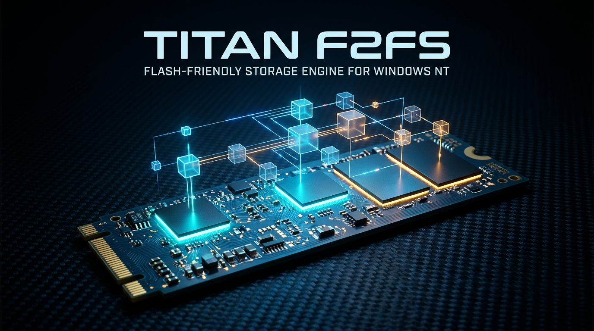

<div align="center">



# TitanF2FS
### Clean-Room Flash-Friendly File System (F2FS) Storage Engine & WinFsp Mount Bridge for Windows NT & MicaNT

[](https://github.com/MicaNT-Kernel/TitanF2FS/actions/workflows/ci.yml)
[](LICENSE)
[]()
[]()

</div>

---

## Overview

**TitanF2FS** brings native support for Samsung's **Flash-Friendly File System (F2FS)** to Windows NT and the MicaNT operating system without third-party kernel drivers or proprietary components.

Designed specifically for NAND flash memory devices (NVMe SSDs, eMMC, SD cards, and USB flash memory), F2FS utilizes a log-structured file system (LFS) architecture that optimizes write amplification, prevents wear-out hotspots, and delivers high throughput.

With TitanF2FS, Windows users and administrators can format, verify, scrub, and mount F2FS partitions, SD cards, Android storage media, and disk images directly to Windows drive letters (`F:\`).

---

## Architectural Highlights

- **Userland Storage Engine**: Zero kernel-mode drivers; 100% crash-isolated execution in user space via the WinFsp user-mode filesystem framework.
- **Pure ISO C++23 Engine**: Clean-room implementation handling Superblock (`0xF2F52010`), Checkpoint blocks, Segment Information Table (SIT), Node Address Table (NAT), Segment Summary Area (SSA), Inode table, and dentry blocks.
- **Log-Structured Consistency Scrubber**: `titanf2fs_check.exe` verifies segment allocations, checkpoint validity, and directory health.
- **Background Service Daemon**: `titanf2fs_svc.exe` runs as a Windows NT service providing Named Pipe IPC (`\\.\pipe\titanf2fs_ipc`) for disk discovery, hot-plugging, and automated mounting.
- **1-Click Dark-Mode GUI Installer**: Self-contained `titanf2fs_setup.exe` with bundled WinFsp MSI and LZ4-compressed payloads.

---

## Command-Line Tools

### 1. Format Volume (`titanf2fs_format.exe`)
```powershell
# Format an SD card, virtual disk, or partition to F2FS
titanf2fs_format.exe \\.\PhysicalDrive2 --label "SamsungSD"
titanf2fs_format.exe flash_drive.img --size 512 --label "TitanFlash"
```

### 2. Consistency Checker & Scrubber (`titanf2fs_check.exe`)
```powershell
# Inspect and scrub an F2FS disk
titanf2fs_check.exe flash_drive.img
```

### 3. WinFsp Mount Driver Bridge (`titanf2fs_mount.exe`)
```powershell
# Mount an F2FS volume to drive F:
titanf2fs_mount.exe flash_drive.img F:
```

### 4. Background Service (`titanf2fs_svc.exe`)
```powershell
# Install and run as a Windows NT service
titanf2fs_svc.exe --install
titanf2fs_svc.exe --run
```

---

## Clean-Room Legal Provenance

TitanF2FS is an independent, clean-room implementation developed in strict adherence to:
- **17 U.S.C. § 1201(f)** (Reverse Engineering for Interoperability)
- **_Google LLC v. Oracle America, Inc._**, 141 S. Ct. 1183 (2021)
- **_Sony Computer Entertainment, Inc. v. Connectix Corp._**, 203 F.3d 596 (9th Cir. 2000)

Refer to [CLEAN_ROOM_PROVENANCE.md](CLEAN_ROOM_PROVENANCE.md) for full compliance details.

---

## License

TitanF2FS is licensed under the **Apache License, Version 2.0**.
See [LICENSE](LICENSE) for details.
